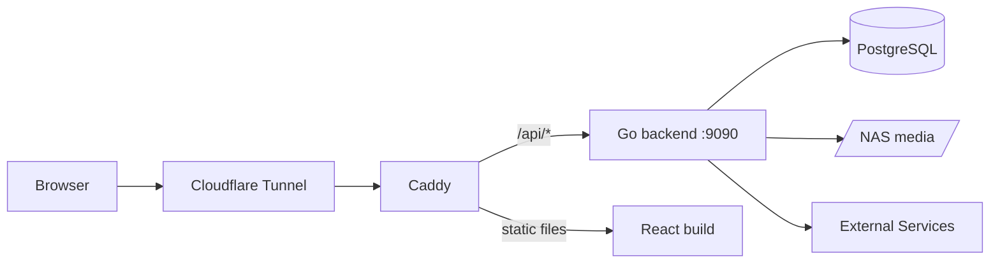

# Architecture

MediaHub is a self-hosted media management platform for content (movies, TV, music, manga, light novels) consumption, tracking, and rating.
This document covers how the project is structured and the general flow. For setup and installation, see [README.md](README.md).

## System Overview



The browser reaches the application through a Cloudflare tunnel, which forwards traffic to Caddy. Caddy serves the built React frontend as static files and forwards anything under `/api/*` to the Go backend without stripping the prefix, so backend routes are registered under `/api`.

The backend is a single Go binary. It stores metadata, users, requests, and progress in PostgreSQL, reads media files from the NAS (mounted at the path in `MEDIA_ROOT`), and talks to the external services listed in [External Integrations](#external-integrations).

## Codebase Map

```
backend/
  cmd/api/                 Entry point: loads .env, connects to the DB, starts the server
  internal/
    platform/              Shared infrastructure
      auth/                JWT, refresh tokens, auth middleware, rate limiting
      database/            Postgres connection
      logger/              Logging helpers
      server/              Chi router and all route registration (routes.go)
      utils/               JSON and error response helpers
    handlers/              One folder per domain (media, lists, requests, jobs,
                           search, stream, sync, users, webhooks, music)
    clients/               Wrappers for external APIs (anilist, arr, mangadex,
                           musicbrainz, ytdlp)
    downloader/            Routes approved requests to a download tool and runs
                           yt-dlp / mangal jobs
    cleanup/               Background job that clears old HLS transcodes
  migrations/              Goose migrations for database structure
frontend/
  src/pages/               Any component that is its own page of content
  src/components/          Shared UI: cards, layout, modals, loading/error states
  src/hooks/               Data fetching hooks (requests, jobs, user content, etc.)
  src/services/            Axios API client and request helpers
  src/stores/              Zustand store for global audio playback
  src/utils/               Formatting, status, and validation helpers
```

Backend files follow a `<domain>_<role>.go` naming convention, for example `jobs_handler.go` holds the HTTP handlers for jobs and `jobs_models.go` holds its request and response types. External API clients follow the same idea with `<service>_client.go` and `<service>_types.go`.

## Backend

### Routing
All routes are registered in `internal/platform/server/routes.go`. Every handler is created once at startup, then routes are grouped under `/api` by access level:

- **Public:** auth refresh and logout, the MangaDex cover proxy
- **Webhook secret:** Sonarr/Radarr webhooks, which must send `X-MediaHub-Secret` matching `WEBHOOK_SECRET`. If `WEBHOOK_SECRET` is unset, every webhook is rejected
- **Media token:** byte-serving routes loaded by `<video>`, `<audio>` and `` (HLS segments, music tracks and covers, light novel images). These can't send a Bearer header, so they require a `media_token` query param instead (see [Media tokens](#media-tokens))
- **Rate limited:** register and login, behind a per-IP token bucket. Register also requires a valid invite code
- **Authenticated:** anything a normal user does (browsing, lists, progress, requests, search)
- **Admin:** request approval, job management, library syncs, user management

A `/health` route outside `/api` returns `ok`.

### Handlers
Every domain package exposes a `Handler` struct built by `NewHandler(db *sql.DB)`. The handler only receives the database connection. Any external clients it needs (Sonarr, AniList, etc.) are created inside `NewHandler` rather than passed in from the router. Responses go through the helpers in `platform/utils` so errors are returned in a consistent shape.

### Auth and Permissions
- **Sign up is invite only.** Admins create single use codes (`POST /api/admin/invites`) on the User Management page and share the code or a `/login?invite=CODE` link. Codes expire after 1 to 30 days (7 by default). Only a SHA-256 hash of each code is stored, in `invite_codes`, so a code is shown once when it is created. `Register` checks the code before hashing the password, then claims it and creates the user in one transaction: a code can't be used twice, and a failed sign up (for example a taken email) frees it again. Unused invites can be revoked; used ones are kept as a record of who invited whom.
- **Login** checks the password with bcrypt and returns two tokens: a JWT access token (24 hours) and a random refresh token (30 days). Only a SHA-256 hash of the refresh token is stored, in `refresh_tokens`.
- **Requests** send the access token as `Authorization: Bearer <token>`. `auth.Middleware` validates it and puts the user's ID and role into the request context.
- **User identity** is always read from context with `auth.GetUser(r)`, never from the request body.
- **Roles:** `user` or `admin`. `auth.RequireAdmin` blocks non-admins from the admin route group.
- **Download permission** is separate from role. `vetted` users' requests wait for admin approval, `auto_approved` users' requests are dispatched immediately.
- Passwords must be at least 12 characters with upper, lower, number, and special characters.

### Media tokens
- Authenticated endpoints (`GET /stream/media/{type}/{id}`, `GET /stream/music/{id}/url`, light novel `content`) mint a media token and return URLs with `?media_token=...` appended.
- Media tokens are JWTs signed with `MEDIA_SIGNING_SECRET` (never `JWT_SECRET`) with `typ: "media"`. Access tokens carry `typ: "access"`. Each validator rejects the other type, so neither token works in place of the other.
- A media token is scoped to one resource (`media_type`, `media_id`, and `volume_id` for light novels). `auth.RequireMediaToken` requires the route params to equal the scope exactly, so a token for episode `1` does not work for episode `12`.
- Music sync stores covers as `/api/stream/music/{id}/cover`. Handlers that return `cover_image_url` call `auth.SignCoverURL` so `` tags get a signed URL.
- Tokens are issued on the hour, so repeat requests get the same URL and the browser can cache covers. They last 1 to 2 hours. `PlayerPage` and `AudioPlayer` fetch a new one and resume at the current position when a load fails with 401.
- When serving `playlist.m3u8`, the stream handler appends the request's token to each segment URI so HLS.js's relative segment fetches stay authorized.
- Tokens in query strings show up in reverse proxy access logs and browser history. That's acceptable for 2-hour, single-resource, read-only tokens, but don't put longer lived secrets in URLs.

## Frontend

### Routing
Routes are defined in `App.jsx` with React Router. `/login` is public. Everything else is wrapped in `ProtectedRoute`, which redirects to login without a token. Most pages render inside `Layout` (sidebar plus content area). The video player at `/watch/:type/:id` sits outside `Layout` so it can use the full screen.

### State
- **Global:** only audio playback (`useAudioStore`). The current track and queue need to survive page changes, so `AudioPlayer` is rendered outside the routes and reads from the store.
- **Server data:** fetched per page through the hooks in `src/hooks`, not cached globally.
- **Auth:** the access and refresh tokens live in `localStorage`. The Axios client in `services/api.js` attaches the access token to every request. On a 401 it tries one refresh, retries the original request, and sends the user to `/login` if the refresh fails.

## Data Model

| Table | Holds |
|-------|-------|
| `users`, `refresh_tokens` | Accounts, role, download permission, hashed refresh tokens |
| `invite_codes` | Hashed single use sign up codes, who created them, expiry, and which user used them |
| `media_items` | One row per title of any type. Unique on `(external_id, external_source)` |
| `anime_metadata`, `movie_metadata`, `manga_metadata`, `light_novel_metadata`, `music_metadata` | Type-specific details, one-to-one with `media_items` |
| `albums` | Music albums. Tracks link to them through `music_metadata.album_id` |
| `episodes` | Anime episodes with file paths, filled in by Sonarr webhooks |
| `manga_chapters`, `light_novel_volumes` | Readable units with file paths, filled in by library syncs |
| `sonarr_items`, `radarr_items` | Map a media item to its Sonarr series or Radarr movie ID |
| `download_requests` | A user asking for something to be downloaded, plus approval state |
| `download_jobs` | The actual download work for an approved request, with handler, status, and progress |
| `user_media_status` | A user's list entry (current, planned, completed, etc.) and rating |
| `user_episode_progress`, `user_anime_progress`, `manga_progress`, `light_novel_progress` | Per-user watch and read progress |

See [`backend/migrations/`](backend/migrations/) for the full schema.

## Key Flows

### Requesting a Download
1. The user finds a title on the Discover page, which searches AniList (anime, movies) or MangaDex (manga) through `GET /api/search`.
2. Saving or requesting it creates a `media_items` row if one doesn't exist yet (`POST /api/search/save`), then `POST /api/requests` creates a `download_requests` row.
3. `requests_handler` checks the user's download permission. `vetted` requests stay `pending` until an admin approves them from the Downloads page. `auto_approved` requests are approved right away.
4. On approval, `downloader.Dispatch` picks a destination folder under `MEDIA_ROOT` and a handler based on media type, then inserts a `download_jobs` row:
   - anime → Sonarr (`TV Shows`)
   - movie → Radarr (`Movies`)
   - manga → mangal (`Manga`)
   - music and anything else → yt-dlp (`Music` / `Downloads`)
5. Sonarr and Radarr download on their own schedule. mangal and yt-dlp run in a goroutine that updates the job's status and progress as it goes.
6. When Sonarr or Radarr finishes, it calls `/api/webhooks/sonarr` or `/api/webhooks/radarr`. The webhook handler writes the file path into `episodes` or `movie_metadata`, which makes the content playable.

### Playback
1. `PlayerPage` calls `GET /api/stream/media/{type}/{id}` with its access token.
2. `stream_handler` looks up the file path and checks for an existing transcode in `MEDIA_ROOT/temp/<type>-<id>`. If there isn't one, it starts ffmpeg to produce HLS segments (`h264_amf` on the AMD GPU, `yuv420p` for 10-bit sources) and extracts subtitles to WebVTT.
3. Once the playlist exists, the handler returns playlist and subtitle URLs signed with a media token. HLS.js loads segments from `/api/stream/segments/...`, and the token is carried on each segment URI in the rewritten playlist.
4. The player resumes from the saved position and saves progress every 5 seconds and on unmount through `PUT /api/episodes/{id}/progress`.
5. The `cleanup` package deletes transcode folders older than 48 hours, checking once an hour.

### Library Sync
Admins can trigger syncs from the backend for each media type (`/api/admin/sync/*`):
- **Sonarr / Radarr:** pull the library from the *arr API, map TVDB or TMDB IDs to AniList IDs using the Fribb anime-lists mapping, and fetch metadata from AniList by ID.
- **Manga, light novels, music:** scan the matching folder under `MEDIA_ROOT` and create or update rows for what's on disk.

## External Integrations

| Service | Used for | Notes |
|---------|----------|-------|
| AniList | Anime and movie search, metadata enrichment | GraphQL. Rate limit of 90 req/min, so syncs sleep between calls |
| Fribb anime-lists | TVDB/TMDB → AniList ID mapping | Fetched from GitHub during syncs. Avoids unreliable title matching |
| MangaDex | Manga search and metadata, cover images | Covers are fetched through `/api/proxy/cover`, which only allows `uploads.mangadex.org` |
| Sonarr | Anime downloads and library | Notifies MediaHub through a webhook on download |
| Radarr | Movie downloads and library | Notifies MediaHub through a webhook on download |
| qBittorrent | Torrent client behind Sonarr and Radarr | MediaHub never talks to it directly |
| mangal | Manga downloads | Run as a subprocess, path from `MANGAL_PATH` |
| yt-dlp | Music search and downloads | Run as a subprocess. Progress is read from its output |
| ffmpeg | HLS transcoding and subtitle extraction | Uses AMD hardware encoding (`h264_amf`) |
| MusicBrainz | Music metadata | Client exists but is not wired into any handler yet |

## Design Decisions

### Custom HLS streaming instead of Plex
**Context:** Playback originally went through Plex, which meant a second account system and app outside MediaHub.
**Decision:** Transcode to HLS with ffmpeg and play it in the browser with HLS.js.
**Why:** Keeps playback and progress tracking inside MediaHub under one login. Transcoding on demand and caching the result means the first play is slower, but later plays are instant until cleanup removes it.

### ID-based metadata enrichment
**Context:** Matching Sonarr/Radarr titles to AniList by name kept producing wrong or missing matches.
**Decision:** Use the Fribb anime-lists mappings to go from TVDB/TMDB IDs straight to AniList IDs.
**Why:** IDs are exact, titles aren't. Items with no mapping still sync, just without AniList data.

### Separate role and download permission
**Context:** Some trusted users should be able to download without waiting, but shouldn't be admins.
**Decision:** Keep `role` (user/admin) and `download_permission` (vetted/auto_approved) as two separate columns.
**Why:** Download trust and admin access are different things, and combining them would force giving out admin to skip approval.

### Running directly on Ubuntu instead of Docker on the NAS
**Context:** Moving the stack into Docker on the NAS was considered.
**Decision:** Keep running on the Ubuntu server.
**Why:** The Ubuntu machine has to stay on anyway as the NAS's internet gateway, so moving to Docker would add complexity without removing any hardware.

## Configuration

Backend variables live in `backend/.env`. Frontend variables live in `frontend/.env`.

| Variable | Purpose |
|----------|---------|
| `DB_HOST`, `DB_PORT`, `DB_USER`, `DB_PASSWORD`, `DB_NAME` | PostgreSQL connection |
| `JWT_SECRET` | Signs and validates access tokens |
| `MEDIA_SIGNING_SECRET` | Signs and validates media tokens. Required, and must differ from `JWT_SECRET` |
| `WEBHOOK_SECRET` | Shared secret Sonarr/Radarr send in the `X-MediaHub-Secret` header. Webhooks are rejected while unset |
| `CORS_ORIGIN` | Allowed frontend origin. The server won't start without it |
| `MEDIA_ROOT` | Root media folder on the NAS. Expects `TV Shows`, `Movies`, `Music`, `Manga`, `Light Novels`, and holds `temp/` for transcodes |
| `SONARR_URL`, `SONARR_API_KEY` | Sonarr API access |
| `RADARR_URL`, `RADARR_API_KEY` | Radarr API access |
| `MANGADEX_URL` | MangaDex API base URL |
| `MANGAL_PATH` | Path to the mangal executable |
| `YTDLP_PATH`, `MUSIC_DIR` | yt-dlp executable and music download folder |
| `VITE_API_URL` | Frontend API base URL, set to `/api` |