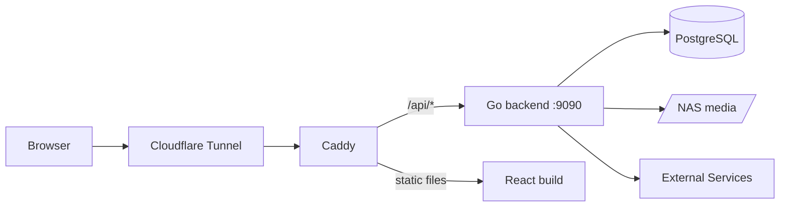

# Architecture

MediaHub is a self-hosted media management platform for content (movies, TV, music, manga, light novels) consumption, tracking, and rating.
This document covers how the project is structured and the general flow. For setup and installation, see [README.md](README.md).

## System Overview



The browser reaches the application through a Cloudflare tunnel, which forwards traffic to Caddy. Caddy serves the built React frontend as static files and forwards anything under `/api/*` to the Go backend without stripping the prefix, so backend routes are registered under `/api`.

The backend is a single Go binary. It stores metadata, users, requests, and progress in PostgreSQL, reads media files from the NAS (mounted at the path in `MEDIA_ROOT`), and talks to the external services listed in [External Integrations](#external-integrations).

## Codebase Map

```
backend/
  cmd/api/                 Entry point: loads .env, connects to the DB, starts the server
  internal/
    platform/              Shared infrastructure
      auth/                JWT, refresh tokens, auth middleware, rate limiting
      cache/               In-memory results from external APIs, local copies of NAS files
      database/            Postgres connection
      logger/              Logging helpers
      server/              Chi router and all route registration (routes.go)
      utils/               JSON and error response helpers
    handlers/              One folder per domain (media, lists, requests, jobs,
                           search, stream, sync, users, webhooks, music, manga,
                           curation, deletion)
    clients/               Wrappers for external APIs (anilist, arr, mangadex,
                           ytdlp)
    downloader/            Routes approved requests to a download tool and runs
                           yt-dlp and MangaDex jobs
    mangafiles/            Manga chapter files: reading chapter numbers from file
                           names, naming chapter files, the page images in a CBZ
    musicfiles/            Album covers: the cover.jpg in each album folder
    novelfiles/            Light novel EPUBs: volume numbers in file names, checking
                           an EPUB opens, finding its cover
    covers/                Covers admins upload for a title, in MEDIA_ROOT/Covers
    locks/                 Fields an admin edited, which syncs leave alone
    uploads/               Large uploads received in chunks
    cleanup/               Background job that clears old HLS transcodes
  migrations/              Goose migrations for database structure
frontend/
  src/pages/               Any component that is its own page of content
  src/components/          Shared UI: cards, layout, modals, loading/error states
  src/hooks/               Data fetching hooks (requests, jobs, user content, etc.)
  src/services/            Axios API client and request helpers
  src/stores/              Zustand store for global audio playback
  src/utils/               Formatting, status, and validation helpers
```

Backend files follow a `<domain>_<role>.go` naming convention, for example `jobs_handler.go` holds the HTTP handlers for jobs and `jobs_models.go` holds its request and response types. External API clients follow the same idea with `<service>_client.go` and `<service>_types.go`.

## Backend

### Routing
All routes are registered in `internal/platform/server/routes.go`. Every handler is created once at startup, then routes are grouped under `/api` by access level:

- **Public:** auth refresh and logout, the MangaDex cover proxy
- **Webhook secret:** Sonarr/Radarr webhooks, which must send `X-MediaHub-Secret` matching `WEBHOOK_SECRET`. If `WEBHOOK_SECRET` is unset, every webhook is rejected
- **Media token:** byte-serving routes loaded by `<video>`, `<audio>` and `` (HLS segments, music tracks and covers, light novel images). These can't send a Bearer header, so they require a `media_token` query param instead (see [Media tokens](#media-tokens))
- **Rate limited:** register, login and account changes, behind a per-IP token bucket (session refresh and logout have a looser one). Register also requires a valid invite code
- **Authenticated:** anything a normal user does (browsing, lists, progress, requests, search)
- **Admin:** request approval, job management, library syncs, user management, editing the library by hand (`/api/admin/media`, `/admin/episodes`, `/admin/uploads`, ...)

A `/health` route outside `/api` returns `ok`.

### Handlers
Every domain package exposes a `Handler` struct built by `NewHandler(db *sql.DB)`. The handler only receives the database connection. Any external clients it needs (Sonarr, AniList, etc.) are created inside `NewHandler` rather than passed in from the router. Responses go through the helpers in `platform/utils` so errors are returned in a consistent shape.

### Auth and Permissions
- **Sign up is invite only.** Admins create single use codes (`POST /api/admin/invites`) on the User Management page and share the code or a `/login?invite=CODE` link. Codes expire after 1 to 30 days (7 by default). Only a SHA-256 hash of each code is stored, in `invite_codes`, so a code is shown once when it is created. `Register` checks the code before hashing the password, then claims it and creates the user in one transaction: a code can't be used twice, and a failed sign up (for example a taken email) frees it again. Unused invites can be revoked; used ones are kept as a record of who invited whom.
- **Login** looks the email up in lower case and checks the password with bcrypt (an unknown email takes as long as a wrong password, so timing doesn't reveal who has an account). It answers with a JWT access token (15 minutes) and sets the session, a random refresh token, as an `HttpOnly`, `SameSite=Strict` cookie on `/api/auth` (`Secure` when the request came over HTTPS), so page scripts can never read it. Only a SHA-256 hash of the refresh token is stored, in `refresh_tokens`. `POST /api/auth/refresh` exchanges the cookie for a new access token and extends the session to 30 days from then; the token isn't replaced, so tabs refreshing at the same moment don't sign each other out.
- **Guessing limits:** besides the per-IP limit, each account allows 5 wrong passwords and then one a minute, from any IP, for login and for account changes. Caddy sets `X-Real-IP` and the backend limits by that rather than the client-controlled `X-Forwarded-For`. Caddy listens twice: `:80`, reachable only inside the Docker network where the tunnel connects, takes the client IP from Cloudflare's `Cf-Connecting-Ip`; `:8081`, published to the LAN as `HTTP_PORT`, always uses the connection's address, so a LAN device can't pick its own rate limit key.
- **Sessions end** on logout (this browser), "Log out everywhere" (`POST /api/auth/logout-all`), a password change (every other session), and an admin resetting a password or changing a role (every session of that user). Access tokens can't be revoked, which is why they last only 15 minutes.
- **Account changes** (`PUT /api/me` for username and email, `PUT /api/auth/password`, under `/api/auth` so the browser sends the session cookie and that session stays signed in) need the current password. Emails are stored trimmed and lower case and must be plain addresses; usernames are 3 to 32 characters. Admins can't change their own role.
- **Requests** send the access token as `Authorization: Bearer <token>`. `auth.Middleware` validates it and puts the user's ID and role into the request context.
- **User identity** is always read from context with `auth.GetUser(r)`, never from the request body.
- **Roles:** `user` or `admin`. `auth.RequireAdmin` blocks non-admins from the admin route group.
- **Download permission** is separate from role. `vetted` users' requests wait for admin approval, `auto_approved` users' requests are dispatched immediately.
- Passwords must be 12 characters to 72 bytes (bcrypt's limit) with upper, lower, number, and special characters.
- **Headers and limits:** Caddy sends a Content-Security-Policy that only runs the app's own scripts, plus `nosniff`, `DENY` framing, `same-origin` referrers (media tokens are in URLs) and HSTS. HTML from outside (EPUB text, AniList descriptions) goes through DOMPurify before it is shown. JSON request bodies are capped at 1 MB, and the server times out clients that send headers slowly. The startup log warns when the admin still has the default password or a signing secret is short.

### Media tokens
- Authenticated endpoints (`GET /stream/media/{type}/{id}`, `GET /stream/music/{id}/url`, light novel `content`) mint a media token and return URLs with `?media_token=...` appended.
- Media tokens are JWTs signed with `MEDIA_SIGNING_SECRET` (never `JWT_SECRET`) with `typ: "media"`. Access tokens carry `typ: "access"`. Each validator rejects the other type, so neither token works in place of the other.
- A media token is scoped to one resource (`media_type`, `media_id`, and `volume_id` for light novels). `auth.RequireMediaToken` requires the route params to equal the scope exactly, so a token for episode `1` does not work for episode `12`.
- Music covers live as `cover.jpg` in each album folder (taken from a track's embedded art by the music sync or after a yt-dlp download, which embeds the video thumbnail, or uploaded by an admin from the album page through `POST /api/admin/albums/{id}/cover`). They are stored as `/api/stream/music/{id}/cover` and served with their real image type and `Cache-Control: no-cache`, so a replaced cover shows up. An album without its own cover shows one of its tracks' covers, in every view. Handlers that return `cover_image_url` call `auth.SignCoverURL` so `` tags get a signed URL: music covers, covers admins uploaded, and light novel covers (an image in the first volume's EPUB).
- Tokens are issued on the hour, so repeat requests get the same URL and the browser can cache covers. They last 1 to 2 hours. `PlayerPage` and `AudioPlayer` fetch a new one and resume at the current position when a load fails with 401.
- When serving `playlist.m3u8`, the stream handler appends the request's token to each segment URI so HLS.js's relative segment fetches stay authorized.
- Tokens in query strings show up in reverse proxy access logs and browser history. That's acceptable for 2-hour, single-resource, read-only tokens, but don't put longer lived secrets in URLs.

## Frontend

### Routing
Routes are defined in `App.jsx` with React Router. `/login` is public. Everything else is wrapped in `ProtectedRoute`, which redirects to login without a token. Most pages render inside `Layout` (sidebar plus content area). The video player at `/watch/:type/:id` sits outside `Layout` so it can use the full screen.

### State
- **Global:** only audio playback (`useAudioStore`). The current track and queue need to survive page changes, so `AudioPlayer` is rendered outside the routes and reads from the store.
- **Server data:** fetched per page through the hooks in `src/hooks`. `useApi` remembers each path's last answer in memory (`services/apiCache.js`, 100 paths), so a page seen before shows its data straight away while it reloads in the background. Signing out clears it.
- **Auth:** the access token lives only in memory (`services/session.js`); the session is the HttpOnly cookie. After a reload `ProtectedRoute` exchanges the cookie for a token before showing the page. The Axios client in `services/api.js` attaches the token to every request; on a 401 it refreshes once (requests failing together share the refresh), retries, and sends the user to `/login` if that fails. Signing out tells other tabs through a `BroadcastChannel`. Browsers signed in before the cookie existed send their stored refresh token once, and it is moved into the cookie and deleted from `localStorage`.

## Data Model

| Table | Holds |
|-------|-------|
| `users`, `refresh_tokens` | Accounts, role, download permission, hashed refresh tokens |
| `invite_codes` | Hashed single use sign up codes, who created them, expiry, and which user used them |
| `media_items` | One row per title of any type. Unique on `(external_id, external_source)`. `locked_fields` names the fields an admin set by hand |
| `anime_metadata`, `movie_metadata`, `manga_metadata`, `light_novel_metadata`, `music_metadata` | Type-specific details, one-to-one with `media_items` |
| `albums` | Music albums with an optional description. Tracks link to them through `music_metadata.album_id` |
| `episodes` | Anime episodes with file paths, filled in by Sonarr webhooks. `title_locked` keeps an admin's title through Sonarr syncs |
| `manga_chapters`, `light_novel_volumes` | Readable units with file paths, filled in by library syncs |
| `sonarr_items`, `radarr_items` | Map a media item to its Sonarr series or Radarr movie ID |
| `download_requests` | A user asking for something to be downloaded, plus approval state |
| `download_jobs` | The actual download work for an approved request, with handler, status, and progress |
| `user_media_status` | A user's list entry (current, planned, completed, etc.) and rating |
| `user_episode_progress`, `user_movie_progress`, `user_anime_progress`, `manga_progress`, `light_novel_progress` | Per-user watch and read progress |

See [`backend/migrations/`](backend/migrations/) for the full schema.

## Key Flows

### Requesting a Download
1. The user finds a title on the Discover page, which searches AniList (anime, movies) or MangaDex (manga) through `GET /api/search`. Music searches YouTube with yt-dlp (`GET /api/music/yt-search`); results are kept in memory per query for an hour. The yt-dlp release binary unpacks itself on every run, so it gets a local temp folder (`YTDLP_TMPDIR`, `/tmp` in the image) instead of `TMPDIR` on the media disk. When requesting a track, the artist and album fields suggest what the library already has (`GET /api/music/artists`) and adopt its spelling, so a different case doesn't start a second folder.
2. Saving or requesting it creates a `media_items` row if one doesn't exist yet (`POST /api/search/save`), then `POST /api/requests` creates a `download_requests` row. Titles are shared, so a save never changes one already in the library: its metadata is fetched and its download dispatched by the external id the library has, not the one sent (an admin's save may fill in a missing one), and a track keeps its artist and album.
3. `requests_handler` checks the user's download permission. `vetted` requests stay `pending` until an admin approves them from the Downloads page. `auto_approved` requests are approved right away.
4. On approval, `downloader.Dispatch` picks a destination folder under `MEDIA_ROOT` and a handler based on media type, then inserts a `download_jobs` row:
   - anime → Sonarr (`TV Shows`)
   - movie → Radarr (`Movies`)
   - manga → MangaDex (`Manga`)
   - music and anything else → yt-dlp (`Music` / `Downloads`)

   yt-dlp only ever gets `https://www.youtube.com/watch?v=<id>` rebuilt from an 11 character video id (`ytdlp.CanonicalURL`), checked when the request is saved, again in `Dispatch` and again before running, and always passed after `--` so it can't be read as an option. Artist and album names become folders, so `musicfiles.CleanName` strips path separators, leading dots, characters file systems refuse and the `%` of yt-dlp's output templates.
5. Sonarr and Radarr download on their own schedule. MangaDex and yt-dlp jobs run in a goroutine that updates the job's status and progress as it goes. Manga is fetched straight from the MangaDex API by the title's MangaDex id: every English chapter it hosts (licensed chapters that only link to the publisher are skipped) is saved as `Manga/<title>/[0012] Chapter 12 - <title>.cbz`. Chapters already on disk are kept, so requesting a manga again fills in what is missing. Because these jobs live inside the backend, a restart ends them: on startup any MangaDex or yt-dlp job still `queued` or `downloading` is marked `failed` ("interrupted by a server restart"), so it can't block deleting its title.
6. When Sonarr or Radarr finishes, it calls `/api/webhooks/sonarr` or `/api/webhooks/radarr`. The webhook handler writes the file path into `episodes` or `movie_metadata`, which makes the content playable.
7. On the Downloads page admins can filter requests and jobs by status and title, and archive them (`POST /api/requests/archive`, `POST /api/admin/jobs/archive` with the ids shown). Archiving only sets `archived_at`, hiding the row from the Active lists; the Archived view (`?archived=true`) lists them again to restore. Archiving a whole list needs a status or title filter first, so pending requests and running jobs aren't swept away by accident.

### Playback
1. `PlayerPage` calls `GET /api/stream/media/{type}/{id}?start=<resume seconds>[&audio=<stream index>]` with its access token.
2. `ffprobe` lists the file's tracks (cached per file until it changes) and `stream_tracks.go` picks them using the user's language preferences (`preferred_audio_language`, `preferred_subtitle_language` on `users`, default Japanese / English):
   - **Audio:** the `audio` parameter if given, otherwise the preferred language (default-flagged first), otherwise the file's default track, skipping commentary. A preference of `default` always uses the file's default track.
   - **Subtitles:** every text track (ASS, SRT, ...) is extracted; image tracks (PGS, VobSub) can't become WebVTT and are skipped. The default shown is full dialogue in the preferred subtitle language, avoiding signs/songs-only, SDH and dubtitle tracks. If the audio is already in that language only a signs/songs track is turned on. A preference of `off` shows none.
3. Each audio choice is its own transcode in `MEDIA_ROOT/temp/<type>-<id>-a<audio index>`. Concurrent requests share a running transcode; a finished one (playlist ends with `#EXT-X-ENDLIST` and `stream.json` exists) is reused. Anything else in the folder is left over from a failed or interrupted run and is deleted before starting again. `stream.json` records the audio and subtitle tracks so the default subtitle can be worked out per request.
4. Every ffmpeg and ffprobe input is opened with `-protocol_whitelist file`, so a file that is really a playlist or a reference elsewhere can't make the server send requests; admin uploads are also limited to the formats allowed for them (`-format_whitelist`). ffmpeg writes an `EVENT` HLS playlist with 4 second segments (keyframe forced at each), `h264_amf` capped at ~6 Mbps, and stereo AAC. AV1 sources are decoded on the GPU (`d3d11va` on Windows, `TRANSCODE_HWACCEL` elsewhere) because CPU AV1 decoding is the slowest step. ffmpeg's output goes to `transcode.log` in the folder and is logged if it fails.
5. Subtitles are extracted in one pass to `subs_<index>.vtt`, written as `.tmp`, cleaned, then renamed so the player never loads a partial file. Cleaning strips leftover ASS override tags (`{...}`), drops ASS vector drawings used for typesetting (which WebVTT shows as walls of coordinates) and drops repeated lines (ASS draws some lines several times for styling).
6. The handler waits until the playlist covers the start position plus 12 seconds (or the transcode finishes, up to 90 seconds), then returns the playlist URL, the file's audio tracks (with the one in use marked), and the subtitle tracks (with the default marked), all signed with a media token. Segment URLs are `/api/stream/segments/{type}/{id}/a<audio>/{file}`. `ServeSegment` only serves `.m3u8`, `.ts` and `.vtt` files.
7. HLS.js starts at the resume position. The player downloads each subtitle file itself, retrying while it's still being extracted, and only adds a `<track>` once the file is there (a `<track>` that fails to load never retries). The **Languages** menu on the player switches subtitles instantly, switches audio by requesting the other audio transcode and resuming at the current time, and can save the current languages as the user's defaults (`PUT /api/me/preferences`).
8. The player saves progress every 5 seconds and on unmount through `PUT /api/episodes/{id}/progress` or `PUT /api/movies/{id}/progress`. Movie details include the saved position so the page can offer Resume.
9. The `cleanup` package deletes transcode folders older than 48 hours, checking once an hour.

### Caching
- **Discover lists** (AniList, MangaDex) are kept in memory for an hour, and for up to a day after that they are still answered straight away while they are fetched again in the background. They are fetched at startup so the first visit doesn't wait. Text searches are kept 15 minutes and YouTube searches an hour (`platform/cache.Memo`).
- **MangaDex covers** in search results use MangaDex's 512px thumbnails. The cover proxy keeps every cover it fetches on disk and tells browsers to keep it for a week.
- **NAS files** (manga chapters, light novel EPUBs, music tracks and covers) are read through `cache.Disk().Local(path)`. The first read comes from the NAS while a copy is made on the server's own disk (`CACHE_DIR`, default `/data/.cache/mediahub` in the backend-data volume); later reads use the copy. Copies are named after the file's path, size and modified time, so a changed file is copied again, and the least recently used are deleted past `CACHE_MAX_GB` (default 5, 0 turns it off). Video transcodes stay in `MEDIA_ROOT/temp`.
- **Browsers** keep manga pages and light novel images for a day. Caddy marks the hashed build files under `/assets` as immutable and makes everything else revalidate, so a deploy shows up on the next load.

### Library Sync
Admins can trigger syncs from the backend for each media type (`/api/admin/sync/*`):
- **Sonarr / Radarr:** pull the library from the *arr API, map TVDB or TMDB IDs to AniList IDs using the Fribb anime-lists mapping, and fetch metadata from AniList by ID.
- **Manga, light novels, music:** scan the matching folder under `MEDIA_ROOT` and create or update rows for what's on disk. Files are matched by path first, so a renamed or renumbered title, album, track, chapter or volume keeps its edits: a chapter or volume file already in the library is skipped, a known track is left alone, a light novel folder belongs to whichever title has volumes in it, and an album folder to the album its other tracks are on.
- **Locked fields:** every sync and the Discover save write metadata through `locks.Keep` / `locks.KeepMeta`, which keep a field's current value while it is in `locked_fields`.

### Adding Manga Chapters
A manga's chapters can come from three places, and all of them skip chapter numbers the library already has:
- **MangaDex downloads** (see Requesting a Download). Admins can run one again for any manga linked to MangaDex with `POST /api/admin/manga/{id}/check` (*Check MangaDex for new chapters* on the manga page), which picks up new releases and fills gaps. It reuses the manga's latest download request, or records one for the admin if the manga came from a sync.
- **Uploads:** `POST /api/admin/manga/{id}/chapters` takes one `.cbz`/`.zip` per request (multipart `file`, optional `number`), so each stays under Cloudflare's 100 MB request limit; files up to 500 MB are accepted. The archive must open and hold page images. It is saved beside the manga's other chapters as `[0098] Chapter 98.cbz`.
- **Files dropped into `Manga/<title>/`**, picked up by the library sync.

`mangafiles.ParseChapter` reads the chapter number from a file name for uploads and the sync: `[0098] Chapter 98 - Title`, `c098`, `Ch. 98`, `Chapter 98`, `#98`, or the last number once the series title is removed. Whole volumes (`v12` with no chapter) are skipped, since chapters are numbered. The reader only counts the image files in an archive as pages, sorted naturally (`2.jpg` before `10.jpg`), so `ComicInfo.xml`, folders and unpadded names in imported archives don't break it. CBR (RAR) archives aren't supported.

### Curating the Library
Admins can fix what the metadata sources get wrong from each details page (*Edit details…* and the ⋯ menu on each row). The `curation` package handles it:
- **Details:** `PUT /api/admin/media/{id}` changes the title, description, release date, genres and the type's own fields (studio and status, director and runtime, author, totals, a track's artist and number). Fields left out are untouched and `null` clears one. Every field changed is added to `locked_fields`; `unlock: [...]` hands fields back to the syncs. Handing back the cover clears it and deletes the uploaded file, and the next sync fills in the source's cover. `PUT /api/admin/albums/{id}` renames an album or changes its artist (its tracks credited to the old artist follow), release date or description; two albums can't share a title and artist.
- **Covers:** `POST /api/admin/media/{id}/cover` (multipart image, up to 10 MB) is saved as `MEDIA_ROOT/Covers/<id>` and served at `/api/media/{id}/cover` with a `cover`-scoped media token, `no-cache`, so a replacement shows up. Albums keep using `cover.jpg` in their folder.
- **Pieces:** `PUT /api/admin/episodes|chapters|volumes/{id}` renames an episode (empty goes back to Sonarr's title) or renames and renumbers a chapter or volume. A renumbered chapter or volume file is renamed to match (`[0099] Chapter 99.cbz`, `X Volume 4.epub`), never over another file, so its old number is free and the sync reads the new one. Renumbering is refused while the title is downloading. Tracks are edited as titles (`PUT /api/admin/media/{trackId}`).
- **Adding files:** large files go up in pieces, since Cloudflare refuses requests over 100 MB. `POST /api/admin/uploads` (`name`, `size`, `kind`: `video`, `audio` or `epub`, checked against extension and size limits) starts one; `PUT /api/admin/uploads/{id}` sends chunks of up to 64 MB with an `Upload-Offset` header, answering 409 with what it has when a retry overlaps. Uploads live in `MEDIA_ROOT/temp/upload-<id>/` and in memory, so a restart forgets them and the temp cleanup deletes their files. The finished upload is then named in `POST /api/admin/anime/{id}/episodes` (`TV Shows/<Series>/Season 01/<Series> - S01E05 - Title.mkv`), `/admin/movies/{id}/file` (only for a movie with no file, `Movies/<Title (Year)>/`), `/admin/light-novels/{id}/volumes` (`<Series> Volume 3.epub`; volume 1 gives a coverless title the EPUB's cover) or `/admin/albums/{id}/tracks` (`<Title>.mp3` beside the album's tracks). Files are checked first (ffprobe finds video, or an mp3 and its length; EPUBs must open) and never replace a file. If adding is refused, the upload is handed back so the details can be fixed without sending the file again.

### Removing Content
- **From a list** (any user): `DELETE /api/me/media/{entryId}` deletes only the caller's own list entry; the title stays in the library.
- **One episode, chapter or volume** (admins): `DELETE /api/admin/episodes|chapters|volumes/{id}` removes its file and row, and everyone's progress for it. Refused while the title downloads. For an episode Sonarr knows, Sonarr first stops monitoring it (so it isn't downloaded again) and deletes the file itself; a Sonarr failure stops with 502. Tracks are removed with `DELETE /api/media/{id}`.
- **From the server** (admins, `deletion` package): `DELETE /api/media/{id}` (anime, movie, manga, light novel, track) and `DELETE /api/albums/{id}`. The order makes a failed deletion safe to retry:
  1. Refused with 409 while a download for it is queued or running.
  2. Sonarr/Radarr delete the series or movie with its files (skipped if another item shares the same series). A failure there returns 502 and stops.
  3. Files (and an uploaded cover in `Covers/`): a title folder (`TV Shows/<Series>`, `Movies/<Movie>`, `Manga/<Series>`, `Light Novels/<Series>`, `Music/<Artist>/<Album>`) that no other item has files in is removed whole, so leftover covers or metadata can't be re-imported by the next sync. Otherwise files are removed one by one and emptied folders pruned, never the type folder itself. Every path must be inside `MEDIA_ROOT`; any failure stops before the database. Old transcodes in `temp/` go too.
  4. One transaction deletes the item's `download_jobs` (no `ON DELETE` rule) and the item; lists, progress, episodes, chapters and volumes cascade. `download_requests` keep their history.

## External Integrations

| Service | Used for | Notes |
|---------|----------|-------|
| AniList | Anime and movie search, metadata enrichment | GraphQL. Rate limit of 90 req/min, so syncs sleep between calls |
| Fribb anime-lists | TVDB/TMDB → AniList ID mapping | Fetched from GitHub during syncs. Avoids unreliable title matching |
| MangaDex | Manga search, metadata, cover images and chapter downloads | Covers are fetched through `/api/proxy/cover`, which only allows `uploads.mangadex.org`. Chapter pages come from MangaDex@Home servers, about 40 chapters a minute at most, so downloads pause between chapters |
| Sonarr | Anime downloads and library | Notifies MediaHub through a webhook on download |
| Radarr | Movie downloads and library | Notifies MediaHub through a webhook on download |
| qBittorrent | Torrent client behind Sonarr and Radarr | MediaHub never talks to it directly |
| yt-dlp | Music search and downloads | Run as a subprocess. Progress is read from its output |
| ffmpeg | HLS transcoding and subtitle extraction | Uses AMD hardware encoding (`h264_amf`) |

## Design Decisions

### Custom HLS streaming instead of Plex
**Context:** Playback originally went through Plex, which meant a second account system and app outside MediaHub.
**Decision:** Transcode to HLS with ffmpeg and play it in the browser with HLS.js.
**Why:** Keeps playback and progress tracking inside MediaHub under one login. Transcoding on demand and caching the result means the first play is slower, but later plays are instant until cleanup removes it.

### ID-based metadata enrichment
**Context:** Matching Sonarr/Radarr titles to AniList by name kept producing wrong or missing matches.
**Decision:** Use the Fribb anime-lists mappings to go from TVDB/TMDB IDs straight to AniList IDs.
**Why:** IDs are exact, titles aren't. Items with no mapping still sync, just without AniList data.

### Separate role and download permission
**Context:** Some trusted users should be able to download without waiting, but shouldn't be admins.
**Decision:** Keep `role` (user/admin) and `download_permission` (vetted/auto_approved) as two separate columns.
**Why:** Download trust and admin access are different things, and combining them would force giving out admin to skip approval.

### Docker Compose on the Ubuntu server, not on the NAS
**Context:** Moving the stack into Docker on the NAS was considered. Later the whole app needed to be installable in one step on any Linux or Windows machine, with updates on every push.
**Decision:** Package everything (Postgres, backend, Caddy + frontend, cloudflared, qBittorrent, Sonarr, Radarr, Prowlarr) as one Compose project. Keep running it on the Ubuntu server. CI publishes images to GHCR and Watchtower pulls them.
**Why:** The Ubuntu machine has to stay on anyway as the NAS's internet gateway, so the NAS gains nothing from hosting it. Compose makes the server rebuildable from the repo, and a one-shot bootstrap container does the *arr wiring that used to be manual. The media folder is mounted at the same path in every container, because Sonarr/Radarr file paths are stored verbatim in the database.

## Configuration

Backend variables live in `backend/.env`. Frontend variables live in `frontend/.env`.

| Variable | Purpose |
|----------|---------|
| `DB_HOST`, `DB_PORT`, `DB_USER`, `DB_PASSWORD`, `DB_NAME` | PostgreSQL connection |
| `JWT_SECRET` | Signs and validates access tokens |
| `MEDIA_SIGNING_SECRET` | Signs and validates media tokens. Required, and must differ from `JWT_SECRET` |
| `WEBHOOK_SECRET` | Shared secret Sonarr/Radarr send in the `X-MediaHub-Secret` header. Webhooks are rejected while unset |
| `CORS_ORIGIN` | Allowed frontend origin. The server won't start without it |
| `MEDIA_ROOT` | Root media folder on the NAS. Expects `TV Shows`, `Movies`, `Music`, `Manga`, `Light Novels`, and holds `temp/` for transcodes |
| `TRANSCODE_ENCODER` | Optional. H.264 encoder: `amf` (default on Windows), `vaapi` (Linux AMD/Intel GPU, device from `TRANSCODE_VAAPI_DEVICE`, default `/dev/dri/renderD128`), `nvenc` (NVIDIA GPU) or `libx264` (CPU, default elsewhere) |
| `ADMIN_PASSWORD` | Optional. Replaces the seeded `admin@example.com` password on startup, only while it is still the default |
| `TRANSCODE_HWACCEL` | Optional. ffmpeg `-hwaccel` used to decode AV1 sources. Defaults to `d3d11va` on Windows and none elsewhere (e.g. set `vaapi` on Linux with an AMD GPU). `none` disables it |
| `SONARR_URL`, `SONARR_API_KEY` | Sonarr API access |
| `LIBRARY_SYNC_HOUR` | Optional. Hour (0-23, local time) of the nightly full library sync. Defaults to 4, `off` disables it |
| `SONARR_QUALITY_PROFILE`, `RADARR_QUALITY_PROFILE` | Optional. Name of the quality profile new series/movies get. Defaults to `Anime`, falls back to profile id 1 if it doesn't exist |
| `RADARR_URL`, `RADARR_API_KEY` | Radarr API access |
| `MANGADEX_URL` | MangaDex API base URL |
| `YTDLP_PATH`, `MUSIC_DIR` | yt-dlp executable and music download folder |
| `VITE_API_URL` | Frontend API base URL, set to `/api` |